<div align="center">

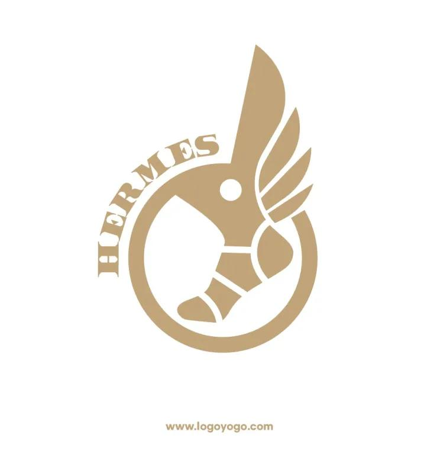

# Talaria

### 두 세계를 잇는 실시간 AI 번역 플랫폼

**비즈니스 회의**와 **K-컬처 라이브**를 하나의 서비스에서.
음성은 자막이 되고, 번역은 문화 맥락까지 전달합니다.

<br/>


-F59E0B?style=flat-square)

-10B981?style=flat-square)

<br/>

> 이 저장소는 Talaria의 **프론트엔드(Frontend)** 입니다.
> 백엔드 · AI 서버는 별도 저장소로 관리합니다. → [관련 저장소](#-관련-저장소)

</div>

---

## 📑 목차

1. [프로젝트 소개](#-프로젝트-소개)
2. [문제 정의와 해결 방향](#-문제-정의와-해결-방향)
3. [핵심 기능](#-핵심-기능)
4. [주요 화면](#-주요-화면)
5. [기술 스택](#-기술-스택)
6. [시스템 아키텍처](#-시스템-아키텍처)
7. [핵심 로직](#-핵심-로직)
8. [파일 구조](#-파일-구조)
9. [시작하기](#-시작하기)
10. [요구사항 대응](#-요구사항-대응)
11. [트러블슈팅](#-트러블슈팅)
12. [성과](#-성과)
13. [역할 및 기여](#-역할-및-기여)
14. [관련 저장소](#-관련-저장소)

---

## 🌍 프로젝트 소개

**Talaria**는 LiveKit 기반 WebRTC 화상회의 위에 **실시간 STT 번역 자막**을 얹은 AI 번역 플랫폼입니다.
용도에 따라 두 가지 모드를 제공합니다.

| | 💼 Business 모드 | 🎤 Culture 모드 |
|---|---|---|
| **목적** | 글로벌 비즈니스 회의 | K-POP · 게임 · 밈 라이브 |
| **핵심 경험** | 정확한 자막 + 회의 흐름 관리 | 문화 맥락 전달 + 몰입형 이펙트 |
| **화면 톤** | 차분한 다크 · 정보 밀도 높음 | 컬러풀 · 인터랙티브 |
| **주요 기능** | 일정 · 문서 번역 · AI 회의 요약 · 매너 코칭 | 테마 배경 · 신조어 하이라이트 · 밈 퀴즈 · 커뮤니티 |

> 하나의 React 프론트엔드에서 두 모드를 모두 지원하며, 헤더의 **모드 전환 토글**로 즉시 오갈 수 있습니다. (모드별 라우트 · 레이아웃 분리)

---

## 🎯 문제 정의와 해결 방향

### 문제 배경

1. **비즈니스 회의의 실시간 이해와 흐름 관리**
   글로벌 미팅에서는 자막 이해, 회의 흐름 파악, 문서 공유 효율이 떨어집니다.
2. **문화 콘텐츠는 직역보다 맥락 전달이 중요**
   밈 · 신조어 · 분위기 · 매너가 함께 전달되지 않으면 소통 몰입도가 낮아집니다.

### 해결 방향

- **LiveKit 기반 WebRTC**로 실시간 화상회의 구현
- **STT 기반 자막 + 번역**을 회의 화면 위에 즉시 오버레이
- 모드를 분리해 **사용 목적에 따라 정보 밀도와 화면 구성을 다르게** 제공
- 회의에서 끝나지 않고 **문서 번역 · 회의록 · 일정 관리**까지 이어지는 서비스형 구조

---

## ✨ 핵심 기능

### 💼 Business

<details open>
<summary><b>1. LiveKit 기반 비즈니스 화상회의</b></summary>

- 참가자 수에 맞춰 영상 타일을 자동 배치하는 **커스텀 그리드**
- 원어(상단) / 번역(하단) 구조의 **실시간 STT 번역 자막 오버레이**
- 우측 사이드바: **채팅 · 문서 · 용어 사전 · 참가자** 탭, 발화 중 **매너 체크 알림** 표시
- 제어 버튼(마이크/카메라/화면공유/나가기) 중앙 하단 고정
- **문서 공유 모드** — 원문 / 번역 PDF를 회의 화면에 띄우고, **페이지 이동을 모든 참가자와 동기화**
- 입장 전 **Pre-flight Check** — LiveKit `PreJoin`으로 카메라 · 마이크 선택, 미리보기, 이름 입력
</details>

<details>
<summary><b>2. 대시보드 · 일정 관리</b></summary>

- 오늘의 회의, 예정 회의, 최근 문서 · 회의록을 카드로 한눈에 확인
- **FullCalendar** 기반 월/주 일정 뷰, **Drag & Drop**으로 일정 등록 · 수정
- 회의 **생성(Create) → 입장(Join)** 까지 원스톱 워크플로우
</details>

<details>
<summary><b>3. 문서 · 회의록 · PDF 뷰어</b></summary>

- 문서 업로드 모달: 문서 이름, 원문 언어, **RAG(문맥 기반 번역)** 사용 여부 설정
- **Drag & Drop** 업로드(react-dropzone) + 확장자 · 용량(최대 100MB) 검사, 업로드 진행률 표시
- PDF 뷰어에서 **원문 / 번역본을 나란히 또는 탭**으로 대조
- 회의 시작 전 문서를 선택해 **사전 학습** → 번역 정확도 향상
- 완료된 회의의 **AI 회의 요약**(핵심 안건 · 결정 사항 · Action Item) 및 **AI 미팅 코치** 피드백
</details>

### 🎤 Culture

<details open>
<summary><b>4. 문화 · 밈 인터랙티브 라이브</b></summary>

- 테마별(K-POP · 게임 등) **배경 이펙트 및 오버레이**
- 채팅 속 **신조어 · 밈 단어 실시간 하이라이트**
- 이모지 애니메이션 · 임팩트 버튼으로 화면 이펙트 발생
- 모바일 최적화 레이아웃: 영상 → 제어 버튼 → 탭 순서로 **한 손 조작** 지원
</details>

<details>
<summary><b>5. 가상 배경 · 테마</b></summary>

- 카테고리별 가상 배경: `기본` · `문화` · `특별` · `계절`
- 한옥 정원, 경복궁, 서울 야경, 도쿄 · 뉴욕 · 파리 등 **한국 명소를 카메라 배경으로** 제공
- 클릭 한 번으로 **라이브 룸 전체 분위기**를 바꾸는 테마 변경 (모든 참가자에게 동시에 적용)
- 카메라 OFF 상태에서도 내가 고른 배경이 **다른 참가자 화면에 그대로** 보이도록 동기화 → [핵심 로직](#2-카메라-off-가상-배경-동기화)
</details>

<details>
<summary><b>6. 오늘의 밈 퀴즈 · 커뮤니티</b></summary>

- 최신 유행어 · 문화적 맥락을 학습하는 **참여형 퀴즈** + 즉각적 피드백
- 관심 태그 기반의 다국적 유저 간 **커뮤니티 게시판**
</details>

### 🧩 공통

- **랜딩 페이지** — 비즈니스 / 문화 모드 소개
- **모드별 헤더** — 로고 · 모드 전환 · 알림 · 프로필 (비즈니스 / 문화 디자인을 따로 구성)
- **SweetAlert2** 기반 알림 (완료 · 오류 · 권한 부족)
- **상태 UX** — 오류 일러스트, 모드별 로딩 화면, 회의실 연결 중 네트워크 팁
- **반응형** — PC · 태블릿 · 모바일에 맞춰 영상 타일 수, 사이드바, 버튼 배치 변경

---

## 🖼 주요 화면

| 대시보드 | 일정 관리 | 회의 입장 전 점검 |
|:---:|:---:|:---:|
| 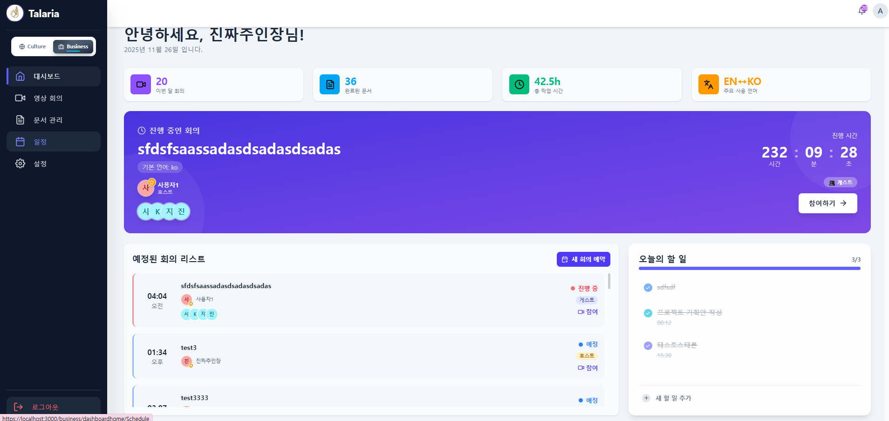 | 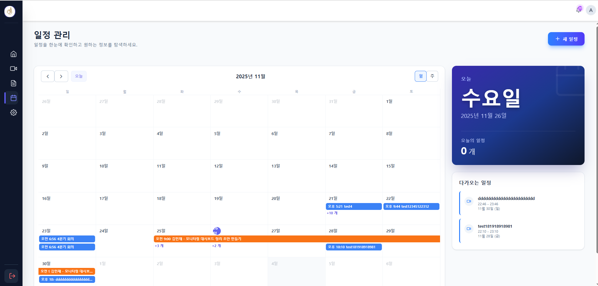 | 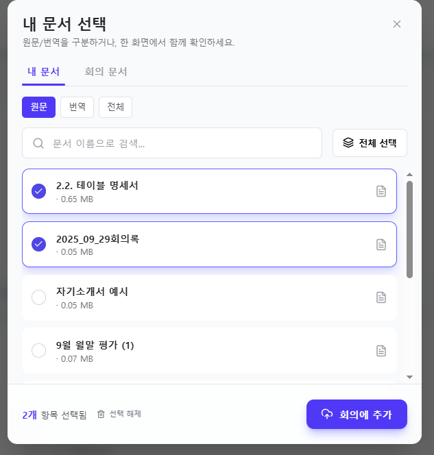 |
| **실시간 자막 오버레이** | **PDF 원문·번역 대조** | **AI 회의 요약 · 코치** |
| 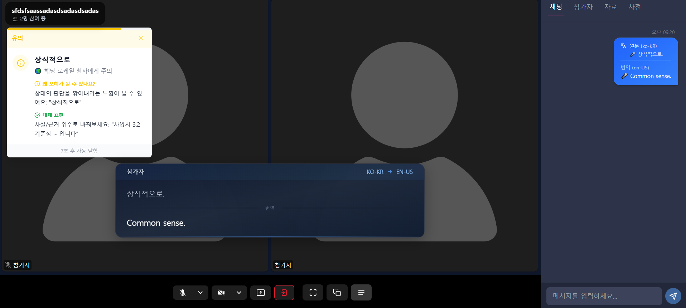 | 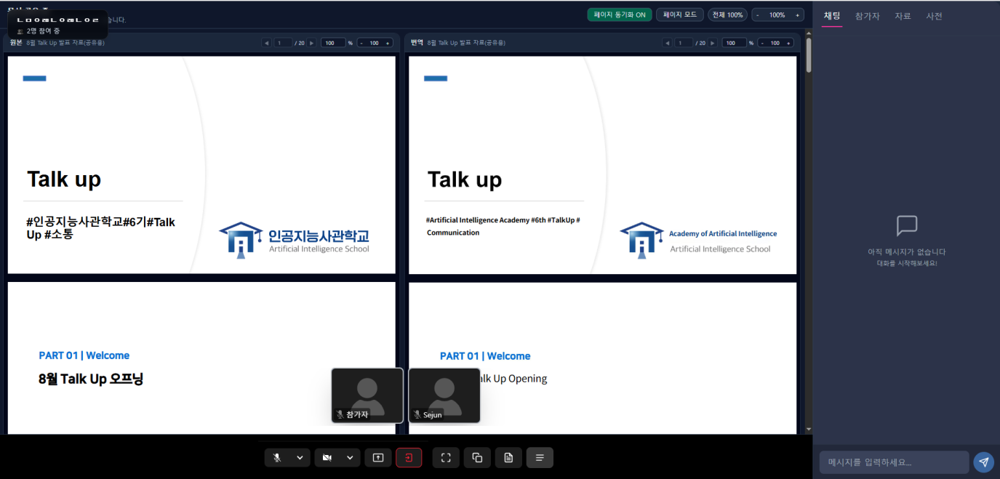 | 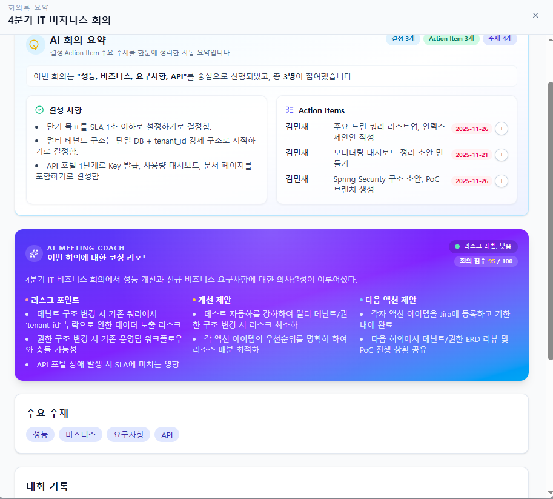 |
| **문화 라이브 홈** | **테마 적용 라이브 룸** | **밈 퀴즈 · 커뮤니티** |
| 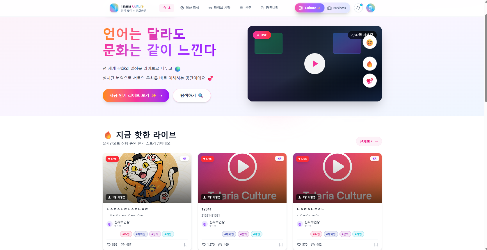 | 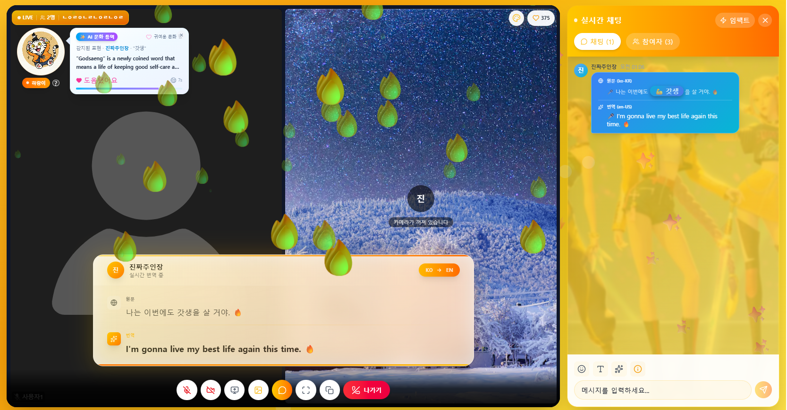 | 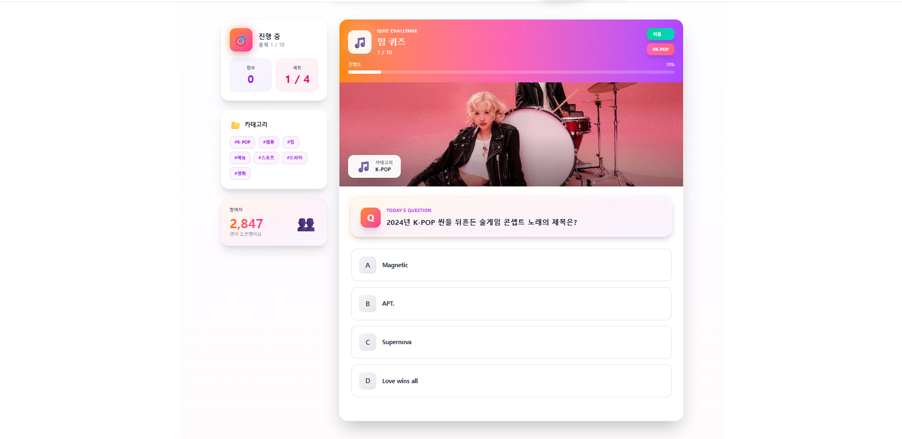 |

---

## 🛠 기술 스택

| 구분 | 기술 |
|---|---|
| **Frontend** |     |
| **실시간 통신** | LiveKit (`livekit-client` · `@livekit/components-react`) · WebRTC · DataChannel · `@livekit/track-processors`(가상 배경) |
| **상태 · 통신** | Context API · Axios · react-router-dom |
| **UI 라이브러리** | FullCalendar · react-pdf(pdf.js) · react-dropzone · SweetAlert2 · Framer Motion |
| **디자인 · 협업** | Figma · GitHub · Notion · Discord |
| **Backend** *(별도 저장소)* | Java · Spring Boot · MySQL |
| **AI** *(별도 저장소)* | Python · LiveKit Agents · FastAPI · LangGraph · CLOVA Speech(STT) · Papago 번역 · OpenAI gpt-4o-mini |

### 기술 선택 이유

| 기술 | 이유 |
|---|---|
| **LiveKit** | 실시간 영상 · 음성 스트림과 참가자 상태 처리에 적합 |
| **Context API** | 로그인 사용자 정보와 번역 설정을 화면 전반에서 일관되게 관리 |
| **Tailwind CSS** | 빠른 UI 구현과 화면 일관성 유지에 유리 |

---

## 🏗 시스템 아키텍처

<p align="center">
  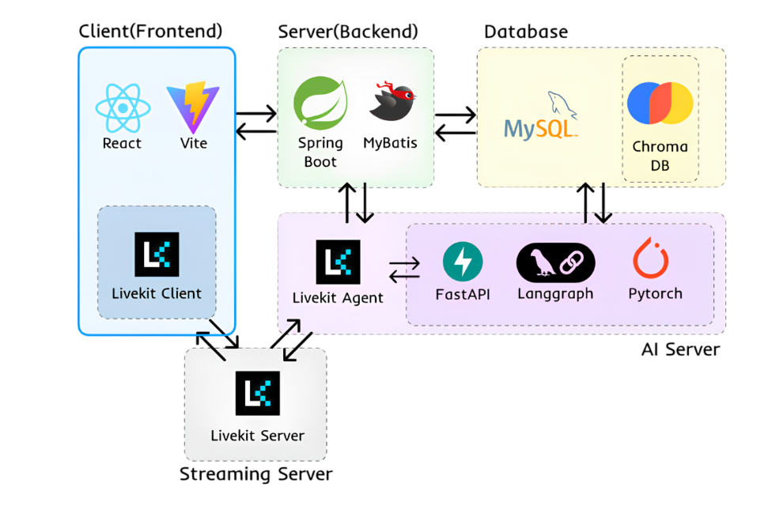
</p>

| 구성 | 역할 |
|---|---|
| **Client (이 저장소)** | React · Vite 화면, LiveKit Client로 영상·음성·DataChannel 송수신, Axios로 백엔드 API 호출 (문서 RAG 처리는 FastAPI 직접 호출) |
| **Streaming Server** | LiveKit Server (WebRTC SFU) — 영상 · 음성 스트림과 DataChannel 메시지 중계 |
| **Server (Backend)** | Spring Boot · MyBatis — 인증, 회의 · 문서 API, LiveKit 접속 토큰 발급 |
| **AI Server** | LiveKit Agent가 회의에 참여해 음성을 받아 자막 · 매너 알림 전송 / FastAPI + LangGraph로 문맥 보정 · 회의 요약 · 문서 RAG / PyTorch로 학습한 밈 분석 모델 |
| **Database** | MySQL(사용자 · 회의 · 문서), ChromaDB(문서 · 밈 사전 벡터 검색) |
| **외부 API** | CLOVA Speech(STT) · Papago(번역) · OpenAI gpt-4o-mini(문맥 보정 · 요약) |

<details>
<summary><b>🧠 AI 에이전트 구조 보기 (AI 담당 팀원 설계)</b></summary>

<p align="center">
  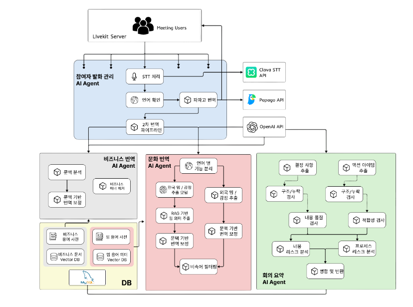
</p>

AI 에이전트가 만든 결과를 프론트엔드에서 이렇게 받아 화면에 보여줍니다.

| AI 결과 | 받는 방법 | 프론트엔드 화면 |
|---|---|---|
| STT + 1·2차 번역 자막 | LiveKit DataChannel `stt` | 원어 / 번역 자막 오버레이 (내 언어에 맞는 번역만 표시) |
| 비즈니스 매너 체크 | LiveKit DataChannel `manner` | 회의 화면 매너 알림 |
| 회의 요약 (결정 사항 · 액션 아이템 · 리스크) | Spring Boot API | 회의록 보기 화면 (AI 회의 요약 · 코치) |

자세한 구조는 [talaria-ai](https://github.com/jingeunlee4559/talaria-ai) 저장소를 참고하세요.
</details>

---

## 🧠 핵심 로직

### 0. LiveKit DataChannel 토픽 설계

화상 · 음성 외의 모든 실시간 정보는 LiveKit **DataChannel**을 토픽별로 나눠 주고받습니다.

| 토픽 | 보내는 쪽 → 받는 쪽 | 용도 |
|---|---|---|
| `stt` | AI Agent → 모든 참가자 | 원문 자막 + 언어별 번역 |
| `manner` | AI Agent → 모든 참가자 | 매너 체크 알림 |
| `chat_messages` | 참가자 ↔ 참가자 | 채팅 |
| `docshare` | 참가자 → 모든 참가자 | 문서 공유 시작/종료 · 원문/번역 레이아웃 |
| `doc-sync` | 참가자 → 모든 참가자 | PDF 페이지 이동 동기화 |
| `theme_change` | 참가자 → 모든 참가자 | 문화 라이브 배경 테마 변경 |
| `virtual_bg_change` | 참가자 → 모든 참가자 | 참가자별 가상 배경 공유 |
| `meeting_control` | 호스트 → 모든 참가자 | 라이브 종료 등 회의 제어 |

### 1. 실시간 자막 파이프라인

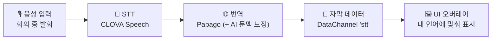

프론트엔드는 **D → E** 구간을 담당합니다.
하나의 자막 메시지에 여러 언어 번역이 함께 오기 때문에, 각 참가자 화면은 **자기 언어(locale)에 맞는 번역만 골라** `원어(상단) / 번역(하단)`으로 보여줍니다. 확정된 문장(final)만 표시하고, 일정 시간이 지나면 자막이 사라집니다.

```jsx
// SubtitleOverlay.jsx (요약)
useDataChannel('stt', (msg) => {
  const data = JSON.parse(new TextDecoder().decode(msg.payload));
  if (!data.final || !data.text?.trim()) return;            // 확정된 문장만

  const myLocale = normalizeLocale(userLocale);
  let translated = data.translations?.[myLocale];             // 예: 'en-US'
  if (!translated && myLocale.includes('-')) {
    translated = data.translations?.[myLocale.split('-')[0]]; // 없으면 'en'으로 한 번 더
  }
  // 원문(data.text) + 번역(translated) 표시 → 일정 시간 뒤 사라짐
});
```

### 2. 카메라 OFF 가상 배경 동기화

<table>
<tr>
<td width="50%" valign="top">

**❌ Before**

- 가상 배경 선택이 **내 화면의 로컬 상태**로만 저장
- 다른 참가자에게 전파되지 않음
- 카메라를 끄면 참가자마다 **서로 다른 화면**

</td>
<td width="50%" valign="top">

**✅ After**

- 선택한 배경을 `virtual_bg_change` 토픽으로 **모든 참가자에게 전송**
- 참가자 identity를 키로 하는 **배경 맵(`virtualBgMap`)** 으로 관리
- 카메라가 꺼진 타일은 그 맵의 배경 이미지를 대신 표시

</td>
</tr>
</table>

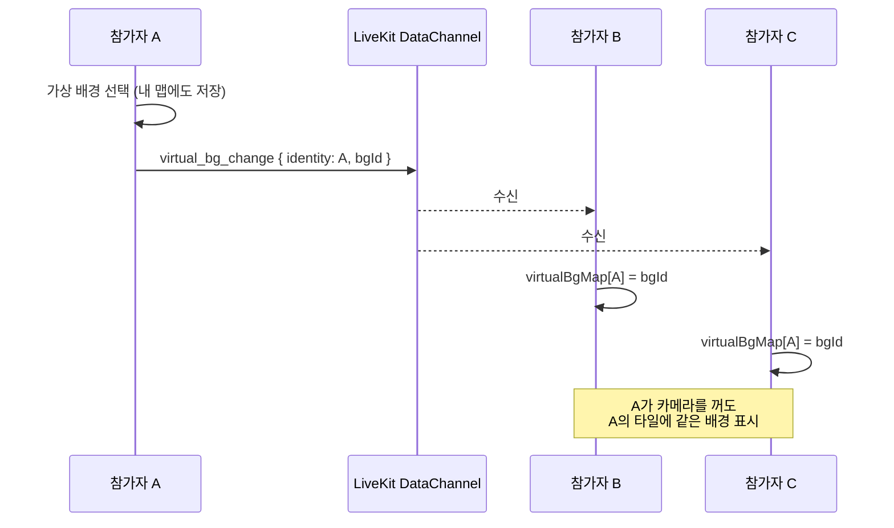

```jsx
// CultureConferenceUI.jsx (요약)
const [virtualBgMap, setVirtualBgMap] = useState({});
const { send: sendVirtualBg } = useDataChannel('virtual_bg_change');

// 송신: 내가 고른 배경을 내 맵에 저장하고 모두에게 알림
const applyVirtualBg = (bgId) => {
  const myId = room.localParticipant.identity;
  setVirtualBgMap((prev) => ({ ...prev, [myId]: bgId }));
  sendVirtualBg(new TextEncoder().encode(
    JSON.stringify({ type: 'virtual_bg', identity: myId, bgId })
  ));
};

// 수신: 다른 참가자의 배경을 맵에 반영
useDataChannel('virtual_bg_change', (msg) => {
  const data = JSON.parse(new TextDecoder().decode(msg.payload));
  if (data.type !== 'virtual_bg' || !data.identity || !data.bgId) return;
  setVirtualBgMap((prev) => ({ ...prev, [data.identity]: data.bgId }));
});

// 렌더: 카메라가 꺼진 참가자 타일은 맵의 배경 이미지로 대체
const getFallbackBackgroundUrlForParticipant = (participant) => {
  const bgId = participant.identity === room.localParticipant.identity
    ? virtualBgId
    : virtualBgMap[participant.identity];
  const preset = findVirtualBgPreset(bgId);
  return preset?.type === 'image' ? preset.imageUrl : null;
};
```

**핵심 포인트**

- 참가자별 배경을 **identity를 키로 한 맵 하나**로 관리해, 어느 화면이든 같은 값을 참조
- 같은 방식(토픽 + 수신 측 상태 반영)을 **테마 변경 · 문서 공유 · PDF 페이지 동기화**에도 적용

> 📌 **남은 과제** — 지금은 배경을 바꾼 *이후의* 변경만 전달되므로, 회의 중간에 들어온 참가자는 기존 참가자가 배경을 다시 바꿔야 반영됩니다. 입장 시 현재 상태를 한 번 요청 · 응답하는 구조로 보완할 수 있습니다.

### 3. 모드 분리 구조

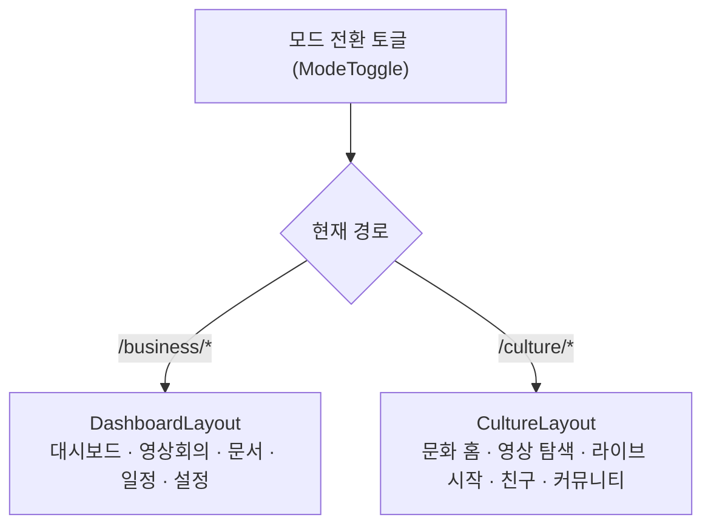

- 모드는 **라우트 + 레이아웃**으로 분리 — 토글을 누르면 현재 경로에 따라 반대 모드의 홈으로 이동
- 모드마다 헤더 · 로딩 화면 · 색상 톤(CSS)을 따로 설계해, 같은 서비스 안에서도 사용 목적에 맞는 분위기를 제공

### 4. 문서 업로드 · RAG 처리 흐름

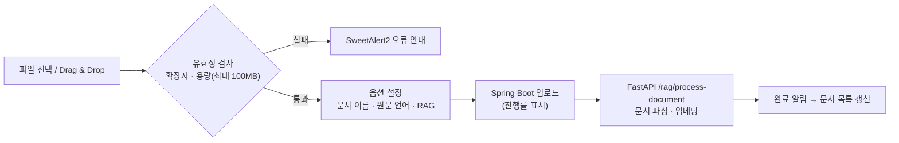

- 지원 확장자: `pdf` `doc` `docx` `ppt` `pptx` `hwp`
- 완료 · 오류 · 권한 부족 상황은 **SweetAlert2**로 통일된 UX 제공

---

## 📁 파일 구조

```
talaria-frontend/
├── docs/screenshots/                 # README 화면 캡처
├── public/
│   ├── img/                          # 로고(hermes_logo.jpg), 랜딩 이미지
│   ├── video/                        # 랜딩 배경 영상
│   └── virtual-bg/                   # 가상 배경 (culture · season · special)
│
├── src/
│   ├── main.jsx · App.jsx
│   ├── axios.jsx                     # Axios 인스턴스 (Spring Boot · FastAPI)
│   ├── routes/Approuter.jsx          # 라우팅
│   ├── layouts/                      # MainLayout · DashboardLayout · CultureLayout
│   ├── contexts/                     # UserContext · TranslationProvider
│   ├── hooks/                        # useVirtualBackground · useKPDHCursor
│   ├── services/livekitService.jsx   # LiveKit 접속 토큰 요청
│   ├── data/cultureQuizData.js       # 밈 퀴즈 데이터
│   │
│   ├── pages/
│   │   ├── Home.jsx · LoginPage.jsx · Register.jsx
│   │   ├── DashBoardPage/            # DashHome · DashVIdeo · DashDocuments · DashSchedule · Dashsettings/
│   │   └── CulturePage/              # CultureHome · CultureViedos · LiveStartPage · FriendsPage · Communitymain · CommunityListPage · CommunityDetailPage
│   │
│   └── components/
│       ├── common/ModeToggle.jsx     # 비즈니스 ↔ 문화 모드 전환
│       ├── home/                     # 랜딩 섹션
│       ├── dashboard/
│       │   ├── dashmain/             # 대시보드 카드 · 진행 중 회의 · 할 일
│       │   ├── dashSchedule/         # 일정 모달 · 오늘 일정
│       │   ├── dashDoc/              # 문서 목록 · 업로드 모달 · 회의록 보기
│       │   └── dashvideo/            # 회의실
│       │       ├── Lobby.jsx              # 입장 전 점검 (PreJoin)
│       │       ├── ConferenceUI.jsx       # 회의 화면 · 문서 공유
│       │       ├── CustomVideoGrid.jsx    # 참가자 타일 그리드 · PDF 페이지 동기화
│       │       ├── SubtitleOverlay.jsx    # 원어/번역 자막
│       │       ├── SyncedPdfGrid.jsx      # 원문/번역 PDF 대조
│       │       ├── MannerChecker.jsx      # 매너 체크 알림
│       │       └── TranscriptSidebarComponents/  # 채팅 · 문서 · 사전 · 참가자 탭
│       └── Culture/
│           ├── CultureHome/          # 핫 라이브 · 오늘의 퀴즈
│           ├── CultureVideo/         # 라이브 화면 · 자막 · 채팅 · 알림
│           └── contents/             # 테마 배경 · 가상 배경 · 이펙트 · 키워드 하이라이트
│
├── index.html
├── package.json
└── vite.config.js
```

---

## 🚀 시작하기

### 요구 사항

- Node.js **18+**
- npm 또는 yarn
- 실행 중인 **Talaria Backend** 및 **LiveKit Server**

### 설치 및 실행

```bash
# 1. 저장소 클론
git clone https://github.com/jingeunlee4559/talaria-frontend.git
cd talaria-frontend

# 2. 의존성 설치
npm install

# 3. 환경 변수 설정 (아래 내용으로 .env 파일 생성)

# 4. 개발 서버 실행
npm run dev

# 5. 프로덕션 빌드
npm run build
npm run preview
```

### 환경 변수 (`.env`)

```env
# Spring Boot API (기본값 http://localhost:8080)
VITE_API_BASE=http://localhost:8080

# FastAPI AI 서버 (기본값 http://127.0.0.1:8000)
VITE_AI_BASE=http://127.0.0.1:8000

# WebSocket (기본값 ws://localhost:8080)
VITE_WS_BASE=ws://localhost:8080
```

> LiveKit 서버 주소와 접속 토큰은 프론트엔드에 따로 넣지 않고, 백엔드(`POST /livekit/token`)에서 받아옵니다.

> 💡 브라우저의 카메라 · 마이크 권한은 **HTTPS 또는 localhost** 환경에서만 요청할 수 있습니다.

---

## 🔄 요구사항 대응

### 비즈니스 전용 → 문화 모드 추가 (개발 약 1.5개월 차)

| | 내용 |
|---|---|
| **상황** | 처음에는 비즈니스 화상회의만 만드는 기획이었으나, 개발 중 **"비즈니스 기능만으로는 무난하고 차별점이 약하다"는 교육과정 담임 선생님의 피드백**을 받음 → 팀 회의에서 프로젝트의 독창성을 논의해 K-컬처 · 밈 라이브를 위한 **문화 모드 추가** 결정 |
| **대응** | 기존 비즈니스 화면에 주는 영향을 줄이도록 **라우트(`/business/*`, `/culture/*`)와 레이아웃을 모드별로 분리**해 새 모드를 추가 · 백엔드의 **모드별 회의 API** 추가 일정에 맞춰 배경 테마 → 라이브 · 커뮤니티 → 문화 영상 목록 · 퀴즈 → 문화 체크 · 채팅 순서로 화면 개발 |
| **결과** | 기존 비즈니스 기능을 유지하면서, **남은 짧은 기간 안에** 문화 모드 화면을 완성해 두 모드를 모두 마무리 |

> 💡 **배운 점**
> 피드백으로 방향이 바뀌는 건 개발 중에도 언제든 생길 수 있는 일이라, **기능 단위로 화면과 라우트를 나눠 두면** 새 요구사항을 기존 기능에 큰 영향 없이 붙일 수 있다는 것을 배웠습니다.

---

## 🔥 트러블슈팅

### 카메라를 끄면 가상 배경이 다른 참가자에게 보이지 않는 문제

| | 내용 |
|---|---|
| **문제** | 카메라 OFF 상태에서 내가 고른 가상 배경이 다른 참가자 화면에 보이지 않아, 참가자마다 서로 다른 화면을 보는 UX 불일치 발생 |
| **원인** | 배경 선택값이 내 화면의 로컬 상태에만 저장되고, 다른 참가자에게 전달하는 경로가 없었음 |
| **해결** | 선택값을 LiveKit DataChannel `virtual_bg_change` 토픽으로 전송하고, 받는 쪽은 참가자 identity를 키로 한 **배경 맵**에 저장 → 카메라가 꺼진 타일은 맵의 배경 이미지로 대체 |
| **결과** | 카메라를 꺼도 모든 참가자 화면에서 같은 배경이 보이고, 같은 구조를 테마 변경 · 문서 공유 · PDF 페이지 동기화에도 재사용 |

> 💡 **배운 점**
> 실시간 서비스에서는 로컬 상태 관리만으로는 일관된 사용자 경험을 보장하기 어렵고, **클라이언트 간 상태 동기화 구조를 함께 설계**해야 합니다.

---

## 🏆 성과

- **2025 실전프로젝트 우수상 (2등)** 수상
- 음성 입력 → STT → 번역 → **자막 오버레이**까지 이어지는 실시간 회의 화면 구현
- 카메라 OFF 배경 테마를 **모든 참가자 화면에서 동일하게** 보이도록 상태 동기화 구조 개선
- 하나의 프론트엔드에서 **비즈니스 / 문화 두 모드**를 목적에 맞는 화면 구성으로 제공
- 회의 · 일정 · 문서 업로드 · PDF 원문/번역 대조 · AI 회의 요약까지 **회의 전후 흐름**을 화면으로 연결

---

## 👤 역할 및 기여

| | |
|---|---|
| **담당** | Frontend 전담 · UI/UX 총괄 |
| **기여도** | 70% |
| **팀 구성** | 프론트엔드 1 · 백엔드 1 · AI 1 (총 3인) |

**담당 업무**

- LiveKit 기반 비즈니스 화상회의 UI — 커스텀 그리드, STT 자막 오버레이, 제어 패널, 멀티태스킹 사이드바
- 문화 · 밈 특화 인터랙티브 UI — 테마 배경, 신조어 하이라이트, 이모지 · 임팩트 효과, 모바일 최적화
- 대시보드 · 일정 · 문서/회의록 · PDF 뷰어(원문-번역 대조) 구현
- 문서 업로드(Drag & Drop · 유효성 검사 · RAG 설정) 및 SweetAlert2 알림 시스템
- 랜딩 · 공통 네비게이션 · PC/태블릿/모바일 반응형 레이아웃
- Figma 기반 UI/UX 설계

---

## 🔗 관련 저장소

| 구분 | 저장소 | 공개 여부 |
|---|---|:---:|
| Frontend | [talaria-frontend](https://github.com/jingeunlee4559/talaria-frontend) | Public |
| Backend | [talaria-backend](https://github.com/jingeunlee4559/talaria-backend-) | Public |
| AI | [talaria-ai](https://github.com/jingeunlee4559/talaria-ai) | Public |

---

<div align="center">

**Made with ❤️ by 이진근 (Jin Geun Lee)**

[📧 wlsrms4559@gmail.com](mailto:wlsrms4559@gmail.com) · [🌐 Portfolio](https://myportfolio-steel-delta.vercel.app/)

</div>
