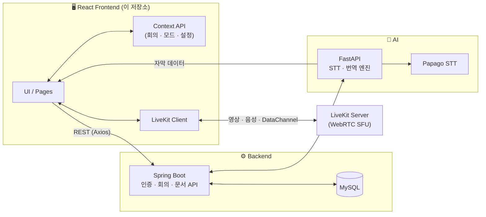
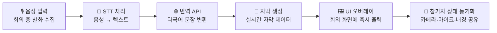
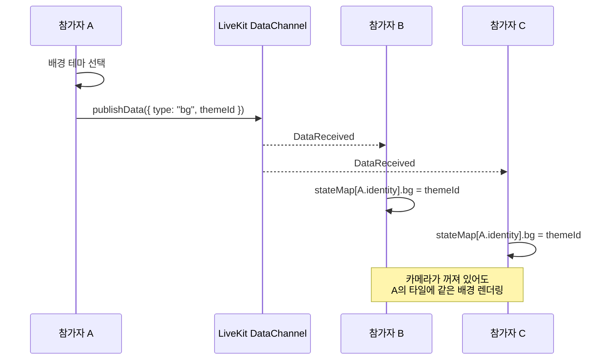
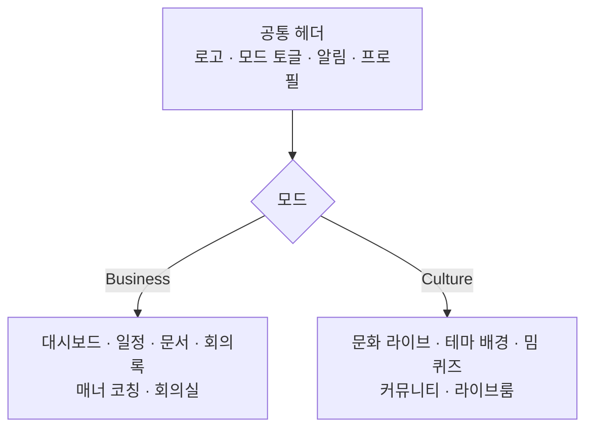
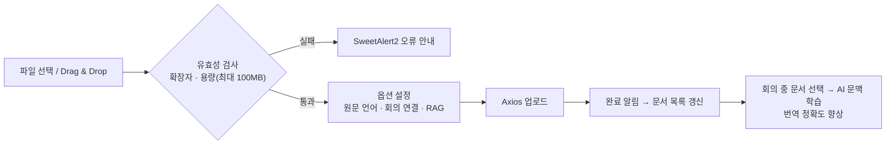

<div align="center">


# Talaria

### 두 세계를 잇는 실시간 AI 번역 플랫폼

**비즈니스 회의**와 **K-컬처 라이브**를 하나의 서비스에서.
음성은 자막이 되고, 번역은 문화 맥락까지 전달합니다.

<br/>


-10B981?style=flat-square)

<br/>

> 이 저장소는 Talaria의 **프론트엔드(Frontend)** 입니다.
> 백엔드 · AI 서버는 별도 저장소로 관리합니다. → [링크](#-관련-저장소)

</div>

---

## 📑 목차

1. [프로젝트 소개](#-프로젝트-소개)
2. [문제 정의와 해결 방향](#-문제-정의와-해결-방향)
3. [핵심 기능](#-핵심-기능)
4. [주요 화면](#-주요-화면)
5. [기술 스택](#-기술-스택)
6. [시스템 아키텍처](#-시스템-아키텍처)
7. [핵심 로직](#-핵심-로직)
8. [파일 구조](#-파일-구조)
9. [시작하기](#-시작하기)
10. [트러블슈팅](#-트러블슈팅)
11. [성과](#-성과)
12. [역할 및 기여](#-역할-및-기여)
13. [관련 저장소](#-관련-저장소)

---

## 🌍 프로젝트 소개

**Talaria**는 LiveKit 기반 WebRTC 화상회의 위에 **실시간 STT 번역 자막**을 얹은 AI 번역 플랫폼입니다.
용도에 따라 두 가지 모드를 제공합니다.

| | 💼 Business 모드 | 🎤 Culture 모드 |
|---|---|---|
| **목적** | 글로벌 비즈니스 회의 | K-POP · 게임 · 밈 라이브 |
| **핵심 경험** | 정확한 자막 + 회의 흐름 관리 | 문화 맥락 전달 + 몰입형 이펙트 |
| **화면 톤** | 차분한 다크 · 정보 밀도 높음 | 컬러풀 · 인터랙티브 |
| **주요 기능** | 일정 · 문서 번역 · AI 회의 요약 · 매너 코칭 | 테마 배경 · 신조어 하이라이트 · 밈 퀴즈 · 커뮤니티 |

> 하나의 React 프론트엔드에서 두 모드를 모두 지원하며, 헤더의 **모드 전환 토글**로 즉시 오갈 수 있습니다.

---

## 🎯 문제 정의와 해결 방향

### 문제 배경

1. **비즈니스 회의의 실시간 이해와 흐름 관리**
   글로벌 미팅에서는 자막 이해, 회의 흐름 파악, 문서 공유 효율이 떨어집니다.
2. **문화 콘텐츠는 직역보다 맥락 전달이 중요**
   밈 · 신조어 · 분위기 · 매너가 함께 전달되지 않으면 소통 몰입도가 낮아집니다.

### 해결 방향

- **LiveKit 기반 WebRTC**로 실시간 화상회의 구현
- **STT 기반 자막 + 번역**을 회의 화면 위에 즉시 오버레이
- 모드를 분리해 **사용 목적에 따라 정보 밀도와 화면 구성을 다르게** 제공
- 회의에서 끝나지 않고 **문서 번역 · 회의록 · 일정 관리**까지 이어지는 서비스형 구조

---

## ✨ 핵심 기능

### 💼 Business

<details open>
<summary><b>1. LiveKit 기반 비즈니스 화상회의</b></summary>

- 참가자 수에 맞춰 영상 타일을 자동 배치하는 **커스텀 그리드**
- 원어(상단) / 번역(하단) 구조의 **실시간 STT 번역 자막 오버레이**
- 우측 사이드바: **매너 체크 · 문서 · 채팅 · 참가자** 탭
- 제어 버튼(마이크/카메라/화면공유/나가기) 중앙 하단 고정
- 입장 전 **Pre-flight Check** — 카메라 · 마이크 미리보기 및 장치 선택
</details>

<details>
<summary><b>2. 대시보드 · 일정 관리</b></summary>

- 오늘의 회의, 예정 회의, 최근 문서 · 회의록을 카드로 한눈에 확인
- **FullCalendar** 기반 월/주 일정 뷰, **Drag & Drop**으로 일정 등록 · 수정
- 회의 **생성(Create) → 입장(Join)** 까지 원스톱 워크플로우
</details>

<details>
<summary><b>3. 문서 · 회의록 · PDF 뷰어</b></summary>

- 문서 업로드 모달: 원문 언어, 회의 연결, **RAG(문맥 기반 번역)** 사용 여부 설정
- **Drag & Drop** 업로드 + 용량 · 확장자 유효성 검사
- PDF 뷰어에서 **원문 / 번역본을 나란히 또는 탭**으로 대조
- 회의 시작 전 문서를 선택해 **사전 학습** → 번역 정확도 향상
- 완료된 회의의 **AI 회의 요약**(핵심 안건 · 결정 사항 · Action Item) 및 **AI 미팅 코치** 피드백
</details>

### 🎤 Culture

<details open>
<summary><b>4. 문화 · 밈 인터랙티브 라이브</b></summary>

- 테마별(K-POP · 게임 등) **배경 이펙트 및 오버레이**
- 채팅 속 **신조어 · 밈 단어 실시간 하이라이트**
- 이모지 애니메이션 · 임팩트 버튼으로 화면 이펙트 발생
- 모바일 최적화 레이아웃: 영상 → 제어 버튼 → 탭 순서로 **한 손 조작** 지원
</details>

<details>
<summary><b>5. 가상 배경 · 테마</b></summary>

- 카테고리별 가상 배경: `기본` · `문화` · `특별` · `계절`
- 한옥 정원, 경복궁, 서울 야경, 도쿄 · 뉴욕 · 파리 등 **한국 명소를 카메라 배경으로** 제공
- 클릭 한 번으로 **라이브 룸 전체 분위기**를 바꾸는 테마 변경
- 카메라 OFF 상태에서도 배경이 **모든 참가자에게 동일하게** 보이도록 동기화 → [핵심 로직](#2-카메라-off-배경-동기화-livekit-datachannel--state-map)
</details>

<details>
<summary><b>6. 오늘의 밈 퀴즈 · 커뮤니티</b></summary>

- 최신 유행어 · 문화적 맥락을 학습하는 **참여형 퀴즈** + 즉각적 피드백
- 관심 태그 기반의 다국적 유저 간 **커뮤니티 게시판**
</details>

### 🧩 공통

- **랜딩 페이지** — 비즈니스 / 문화 모드 소개
- **공통 헤더** — 로고 · 모드 전환 · 알림 · 프로필 재사용
- **SweetAlert2** 기반 알림 (완료 · 오류 · 권한 부족)
- **상태 UX** — 오류 일러스트, 모드별 로딩 화면, 회의실 연결 중 네트워크 팁
- **반응형** — PC · 태블릿 · 모바일에 맞춰 영상 타일 수, 사이드바, 버튼 배치 변경

---

## 🖼 주요 화면

| 대시보드 | 일정 관리 | 문서 선택 |
|:---:|:---:|:---:|
|  |  |  |
| **실시간 자막 오버레이** | **PDF 원문·번역 대조** | **AI 회의 요약 · 코치** |
|  |  |  |
| **문화 라이브 홈** | **테마 적용 라이브 룸** | **밈 퀴즈 · 커뮤니티** |
|  |  |  |

---

## 🛠 기술 스택

| 구분 | 기술 |
|---|---|
| **Frontend** |     |
| **실시간 통신** | LiveKit (Web SDK) · WebRTC · DataChannel |
| **상태 · 통신** | Context API · Axios · react-router-dom |
| **UI 라이브러리** | FullCalendar · SweetAlert2 · PDF Viewer |
| **디자인 · 협업** | Figma · GitHub · Notion · Discord |
| **Backend** *(별도 저장소)* | Java · Spring Boot · MySQL |
| **AI** *(별도 저장소)* | FastAPI (Python) · Papago STT · 번역 엔진 |

### 기술 선택 이유

| 기술 | 이유 |
|---|---|
| **LiveKit** | 실시간 영상 · 음성 스트림과 참가자 상태 처리에 적합 |
| **Context API** | 회의 상태와 사용자 설정을 화면 전반에서 일관되게 관리 |
| **Tailwind CSS** | 빠른 UI 구현과 화면 일관성 유지에 유리 |

---

## 🏗 시스템 아키텍처



| 컴포넌트 | 역할 |
|---|---|
| **LiveKit (WebRTC)** | 영상 · 음성 스트림 처리, 참가자 상태 전파 |
| **Spring Boot** | 사용자 인증, 회의 생성/참여, 문서 관리 API |
| **FastAPI** | STT 및 번역 처리 엔진 |
| **MySQL** | 사용자 · 회의 · 문서 데이터 저장 |

---

## 🧠 핵심 로직

### 1. 실시간 자막 파이프라인



프론트엔드는 **D → E** 구간을 담당합니다.
자막 데이터를 받아 `원어(상단) / 번역(하단)` 구조로 렌더링하고, 새 자막이 들어오면 이전 자막을 교체하거나 일정 시간 후 사라지도록 처리합니다.

### 2. 카메라 OFF 배경 동기화 (LiveKit DataChannel + State Map)

<table>
<tr>
<td width="50%" valign="top">

**❌ Before**

- 배경 설정이 **내 화면의 로컬 상태**로만 변경
- 다른 참가자에게 전파되지 않음
- 카메라 OFF 시 참가자마다 **서로 다른 화면**

</td>
<td width="50%" valign="top">

**✅ After**

- 배경 설정값을 **DataChannel**로 실시간 브로드캐스트
- 참가자별 **State Map**을 구축해 단일 기준으로 참조
- 모든 화면에서 **동일한 배경 테마** 유지

</td>
</tr>
</table>



```jsx
// 송신: 내 배경 설정을 모든 참가자에게 전파
const broadcastBackground = (themeId) => {
  const payload = new TextEncoder().encode(
    JSON.stringify({ type: "background", themeId })
  );
  room.localParticipant.publishData(payload, { reliable: true, topic: "participant-state" });
  updateState(room.localParticipant.identity, { background: themeId }); // 내 화면도 같은 맵으로
};

// 수신: 참가자별 State Map 갱신
useEffect(() => {
  const onData = (payload, participant, _kind, topic) => {
    if (topic !== "participant-state" || !participant) return;
    const msg = JSON.parse(new TextDecoder().decode(payload));
    if (msg.type === "background") {
      updateState(participant.identity, { background: msg.themeId });
    }
  };
  room.on(RoomEvent.DataReceived, onData);
  return () => room.off(RoomEvent.DataReceived, onData);
}, [room]);

// 렌더: 영상 대신 State Map의 배경을 참조
const bg = stateMap[participant.identity]?.background;
```

**핵심 포인트**

- 상태의 **단일 진실 공급원(Source of Truth)** 을 `State Map`으로 통일
- 늦게 입장한 참가자도 같은 값을 받을 수 있도록 입장 시 현재 상태를 동기화
- **구조적 개선**으로 같은 유형의 동기화 문제(마이크, 카메라 상태 등) 재발 방지

### 3. 모드 분리 구조



- 모드 상태는 **Context** 로 관리, 라우팅 · 헤더 · 로딩 화면 · 색상 톤이 모드에 따라 분기
- 같은 컴포넌트(헤더, 알림, 프로필)는 **재사용**하고 화면 구성만 모드별로 다르게 제공

### 4. 문서 업로드 · 사전 학습(RAG) 흐름



- 지원 확장자: `pdf` `doc` `docx` `ppt` `pptx` `hwp`
- 완료 · 오류 · 권한 부족 상황은 **SweetAlert2**로 통일된 UX 제공

---

## 📁 파일 구조

```
talaria-frontend/
├── public/
│   ├── img/                      # 로고(hermes_logo.jpg), 랜딩 이미지
│   ├── video/                    # 랜딩 배경 영상 (back1.mp4, back2.mp4)
│   ├── virtual-bg/               # 가상 배경 리소스
│   │   ├── culture/              # 경복궁·한옥·서울·도쿄·뉴욕·파리 등 한국/해외 명소
│   │   ├── season/               # 봄·여름·가을·겨울 계절 배경
│   │   └── special/              # 콘서트·파티·불꽃놀이 등 특별 테마
│   └── vite.svg
│
├── src/
│   ├── main.jsx                  # 앱 진입점
│   ├── App.jsx                   # 라우팅 · Provider 구성
│   │
│   ├── pages/
│   │   ├── landing/              # 랜딩 (모드 소개)
│   │   ├── business/
│   │   │   ├── Dashboard.jsx     # 오늘 회의 · 일정 · 최근 문서
│   │   │   ├── Meetings.jsx      # 회의 목록 · 생성 · 입장
│   │   │   ├── Calendar.jsx      # FullCalendar 일정 관리
│   │   │   ├── Documents.jsx     # 문서 · 회의록 아카이브
│   │   │   └── MeetingRoom.jsx   # 화상회의 룸 (LiveKit)
│   │   └── culture/
│   │       ├── CultureHome.jsx   # 핫 라이브 · 홈
│   │       ├── LiveRoom.jsx      # 문화 라이브 룸
│   │       ├── MemeQuiz.jsx      # 오늘의 밈 퀴즈
│   │       └── Community.jsx     # 커뮤니티 게시판
│   │
│   ├── components/
│   │   ├── layout/               # Header · ModeToggle · Sidebar
│   │   ├── meeting/
│   │   │   ├── VideoGrid.jsx     # 참가자 타일 자동 배치 그리드
│   │   │   ├── SubtitleOverlay.jsx   # 원어/번역 자막 오버레이
│   │   │   ├── ControlBar.jsx    # 마이크 · 카메라 · 공유 · 나가기
│   │   │   ├── SidePanel/        # 매너 체크 · 문서 · 채팅 · 참가자 탭
│   │   │   └── PreflightCheck.jsx    # 입장 전 장치 점검
│   │   ├── culture/
│   │   │   ├── ThemePicker.jsx   # 라이브 테마 선택
│   │   │   ├── BackgroundPicker.jsx  # 가상 배경 선택
│   │   │   ├── EffectLayer.jsx   # 이모지 · 임팩트 이펙트
│   │   │   └── HighlightText.jsx # 신조어 · 밈 하이라이트
│   │   ├── document/
│   │   │   ├── UploadModal.jsx   # Drag & Drop · 유효성 · RAG 옵션
│   │   │   ├── DocumentList.jsx  # 필터 · 정렬 · 검색
│   │   │   └── PdfViewer.jsx     # 원문/번역 나란히·탭 모드
│   │   └── common/               # Loading · ErrorState · Alert(SweetAlert2)
│   │
│   ├── context/
│   │   ├── ModeContext.jsx       # Business / Culture 모드
│   │   ├── MeetingContext.jsx    # 회의 상태 · 참가자 State Map
│   │   └── AuthContext.jsx       # 사용자 · 인증
│   │
│   ├── hooks/
│   │   ├── useLiveKitRoom.js     # 룸 연결 · 이벤트 구독
│   │   ├── useParticipantState.js    # DataChannel 기반 상태 동기화
│   │   └── useSubtitle.js        # 자막 수신 · 갱신
│   │
│   ├── api/                      # Axios 인스턴스 · 도메인별 API
│   ├── utils/                    # 포맷터 · 파일 검증 · 상수
│   └── styles/                   # 전역 스타일 · Tailwind 설정
│
├── .env.example
├── index.html
├── package.json
├── tailwind.config.js
└── vite.config.js
```

---

## 🚀 시작하기

### 요구 사항

- Node.js **18+**
- npm 또는 yarn
- 실행 중인 **Talaria Backend** 및 **LiveKit Server**

### 설치 및 실행

```bash
# 1. 저장소 클론
git clone https://github.com/jingeunlee4559/talaria-frontend.git
cd talaria-frontend

# 2. 의존성 설치
npm install

# 3. 환경 변수 설정
cp .env.example .env

# 4. 개발 서버 실행
npm run dev

# 5. 프로덕션 빌드
npm run build
npm run preview
```

### 환경 변수 (`.env`)

> 변수명은 예시입니다. 실제 코드에서 사용하는 이름에 맞춰 수정하세요.

```env
# Backend API
VITE_API_BASE_URL=http://localhost:8080

# LiveKit
VITE_LIVEKIT_URL=wss://your-livekit-server
```

> 💡 LiveKit과 푸시/미디어 권한(카메라·마이크)은 **HTTPS 또는 localhost** 환경에서만 정상 동작합니다.

---

## 🔥 트러블슈팅

### 카메라를 끄면 배경 설정이 다른 참가자에게 보이지 않는 문제

| | 내용 |
|---|---|
| **문제** | 카메라 OFF 상태에서 배경 설정이 참가자 간 동기화되지 않아, 다른 참가자 화면에서는 설정한 배경 테마가 유지되지 않는 UX 불일치 발생 |
| **원인** | 로컬 상태만 업데이트되고 다른 참가자에게 전파되지 않음 · 실시간 상태 동기화 메커니즘 부재 |
| **해결** | **LiveKit DataChannel** 로 배경 설정값을 실시간 공유하고, 참가자별 **State Map** 을 구축하여 모든 화면이 같은 값을 참조하도록 구조 개선 |
| **결과** | 모든 참가자 화면에서 배경 테마 일관성 확보 · 실시간 상태 동기화 UX 개선 · 구조적 개선으로 재발 방지 |

> 💡 **배운 점**
> 실시간 서비스에서는 로컬 상태 관리만으로는 일관된 사용자 경험을 보장하기 어렵고, **클라이언트 간 상태 동기화 구조를 함께 설계**해야 합니다.

---

## 🏆 성과

- **2025 실전프로젝트 우수상** 수상
- 실시간 번역 기능을 **회의 흐름 안에 자연스럽게 정착** — 단순 번역이 아닌 끊김 없는 통합 소통 경험
- 참가자 상태 변화와 자막 흐름이 **분리되지 않는 UI 구조**
- 사용 목적에 따라 정보 밀도를 조절하는 **이중 경험 구조**(비즈니스 / 문화)
- 회의에서 **문서 · 기록 관리까지 연결**되는 확장형 서비스 구조

---

## 👤 역할 및 기여

| | |
|---|---|
| **담당** | Frontend 전담 · UI/UX 총괄 |
| **기여도** | 70% |
| **팀 구성** | 프론트엔드 1 · 백엔드 1 · AI 1 (총 3인) |

**담당 업무**

- LiveKit 기반 비즈니스 화상회의 UI — 커스텀 그리드, STT 자막 오버레이, 제어 패널, 멀티태스킹 사이드바
- 문화 · 밈 특화 인터랙티브 UI — 테마 배경, 신조어 하이라이트, 이모지 · 임팩트 효과, 모바일 최적화
- 대시보드 · 일정 · 문서/회의록 · PDF 뷰어(원문-번역 대조) 구현
- 문서 업로드(Drag & Drop · 유효성 검사 · RAG 설정) 및 SweetAlert2 알림 시스템
- 랜딩 · 공통 네비게이션 · PC/태블릿/모바일 반응형 레이아웃
- Figma 기반 UI/UX 설계

---

## 🔗 관련 저장소

| 구분 | 저장소 | 공개 여부 |
|---|---|:---:|
| Frontend | [talaria-frontend](https://github.com/jingeunlee4559/talaria-frontend) | Public |
| Backend | [talaria-backend](https://github.com/jingeunlee4559/talaria-backend-) | Public |
| AI | [talaria-ai](https://github.com/jingeunlee4559/talaria-ai) | Public |

---

<div align="center">

**Made with ❤️ by 이진근 (Jin Geun Lee)**

[📧 wlsrms4559@gmail.com](mailto:wlsrms4559@gmail.com) · [🌐 Portfolio](https://myportfolio-steel-delta.vercel.app/)

</div>
